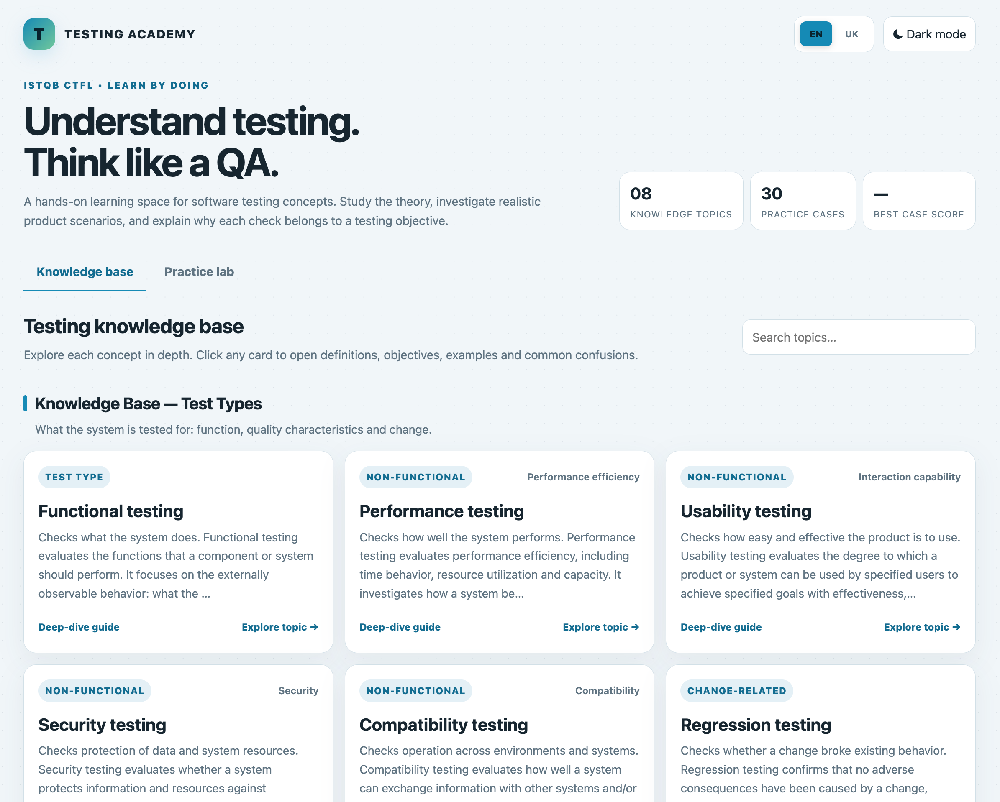

# Testing Academy — QA Learning Lab

An interactive, bilingual (EN / UK) learning app for software testing concepts, aligned with **ISTQB CTFL v4.0.1**. Study the theory, then practice by sorting realistic checks into the right testing category.



**Live demo:** https://yurchykd.github.io/testing-academy/

## Features

- **Knowledge Base — Test Types**: functional, performance, usability, security, compatibility and regression testing, each with a definition, objective, examples and common confusions.
- **Knowledge Base — Test Techniques**:
  - *Black-box*: equivalence partitioning, boundary value analysis (2-value and 3-value), decision table testing, state transition testing.
  - *White-box*: statement testing / statement coverage and branch testing / branch coverage, with a worked code example.
- **Practice Lab**: 30 product scenarios (banking, streaming, healthcare, e-commerce and more), 12 checks each, in three difficulty levels. Drag and drop on desktop, tap-to-place on touch screens, with instant feedback and a review of mistakes.
- **English / Ukrainian** switch for the whole interface and content.
- **Dark / light theme**, responsive layout, keyboard-accessible cards.
- Single self-contained HTML file — no build step, no dependencies.

## Run locally

Just open `index.html` in a browser, or serve the folder:

```bash
python3 -m http.server 8000
# then open http://localhost:8000
```

## Project structure

```
.
├── index.html        # the whole app (HTML, CSS and JS)
├── docs/
│   └── screenshot.png
└── README.md
```

## Content note

This is an independent learning companion. Terminology follows ISTQB CTFL v4.0.1, but the texts and examples are original and the project is not affiliated with or endorsed by ISTQB.

